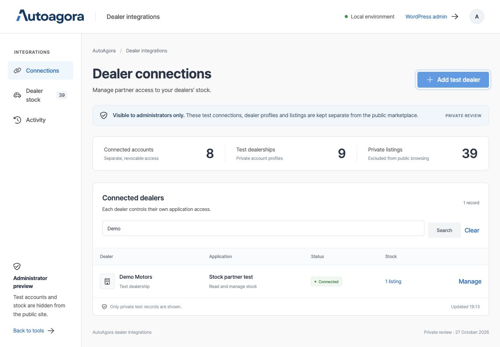
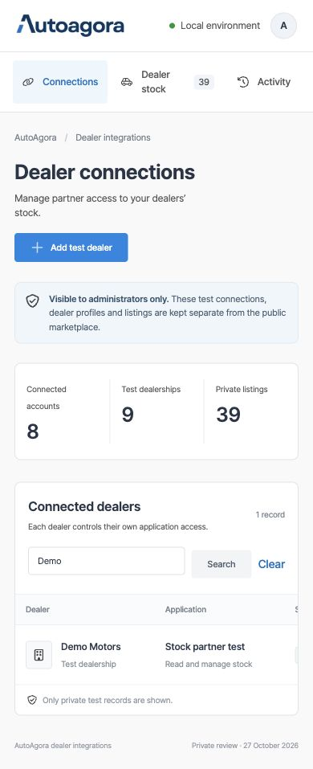

# Local integration verification

Verified on 27 October 2026 using the isolated loopback WordPress copy. Production was not modified. The final verification runs use local image fixtures and do not contact AutoAgora production.

## Administrator-only workspace: current results

The professional workspace is the current local review entry point. The old anonymous partner UI has been retired; port 8898 redirects to the administrator workspace on port 8899.

| Boundary | Result | Evidence |
|---|---|---|
| Administrator workflow and privacy | 77 checks passed | `tests/dealer-integration/review_checks.py`; ignored `.private/review-results.json` |
| Actual browser workflow | Passed | Synthetic administrator created Demo Motors, connected a test app, imported stock, edited its price and reordered photos |
| Responsive layout | Passed | Default desktop and 390 × 844 phone viewport; page width equals viewport after overflow repair |
| Protected images | Passed | Real files outside web root; administrator receives image, visitors/dealers receive 404; public upload files absent |
| Recovery | Passed | Existing records/media remain private with API disabled or dependencies missing; ordinary account page still renders |
| Keyboard dialog behaviour | Passed | Escape closes dialog and returns focus to Add test dealer |

The 77 checks cover administrator-only routes, bearer-only API denial, nonces, test account/profile creation, persisted grants, non-test account rejection, shared stock import/edit/status handling, private photos, ETags and invalid prices, forced-private publication, private single/author/REST/search/query/sitemap boundaries, activity, empty search, grant revocation and retained data. They do not contact production.

Local tests found and fixed ACF’s REST initialization overwriting an early privacy response, WordPress attachment hooks differing from normal post hooks, an admin-menu redirect occurring too late, and an absolutely positioned table label causing phone page overflow.

## Earlier OAuth and native-form baseline

These results were recorded before administrator-only review was enabled. The older suites now refuse to run against the current private fixture. They describe the partner contract for a later separately configured release; they are not a claim that real dealers can onboard in the current review mode. Do not turn on public mode in the current fixture to rerun them. Use a separate disposable installation with no existing review data for future public-contract testing.

## Baseline results

| Boundary | Result | Evidence |
|---|---|---|
| HTTP authorization and stock lifecycle | 96 checks passed | `tests/dealer-integration/http_checks.py`; private result file `tests/dealer-integration/results.local.json` |
| Existing website add/edit forms and API compatibility | 15 checks passed | `tests/dealer-integration/form_checks.py`; private result file `.private/form-results.json` |
| Browser login and consent | Passed with synthetic Dealer One | Actual WordPress login, scope review, approved callback and connected partner UI |
| Browser stock operations | Passed | Sample creation returned 201/pending; price update 200/pending; withdrawal 200/draft/withdrawn; refresh 200 with 3600-second expiry |
| PHP syntax | Passed for changed/new PHP sources | `php -l` |
| Diff whitespace | Passed | `git diff --check` |
| OAuth dependencies | Installed from lock file | League OAuth2 Server 9.4.1; Composer installation reported no known security advisories |

The checks cover scopes, unapproved callbacks, consent nonce/cancellation, one-time codes, S256 requirement, expiry, refresh rotation, revocation and first-party disconnect; dealer and partner separation; stable stock IDs; retry receipts and interrupted-receipt recovery; concurrent creation; ETag conflicts; field validation; showroom defaults/overrides; image count/size/content/failure cleanup; preservation of prior galleries on failure; moderation; sold redirects; reversible withdrawal; and an explicit unavailable view-reporting response.

An injected synthetic allowance rule was also enforced, and the business-rule verification flag was tested disabled. That does not establish compatibility with uninspected hosted plugins or packages.

Native form checks submit two local image files through the original `admin-post` add handler, read the result through the API, edit it through the original edit handler, verify the shared field writer preserves its behaviour and selected order, then verify an API PATCH preserves omitted optional selections. A second dealer is blocked from the native editor.

The browser check caught a form security policy that blocked cross-port OAuth redirects. The policy now allows the callback origin only after the library validates its exact registered URL. Browser authorization and the partner callback were then verified successfully.

## Current workspace images

Earlier consent/withdrawal screenshots are historical public-contract evidence, superseded for UI review by the administrator workspace.

## Limits of this verification

This is a fresh local database with explicit schema fixtures, cached WordPress 7.1.2 and existing archived Bricks/ACF code. The archived plugin emits PHP 8.4 deprecation notices; those dependencies were not upgraded or represented as current hosted versions. The initial absent Maps constant was replaced only in the fixture with a blank value; map/geolocation integrations remain disabled locally.

Hosted plugin/schema parity, real partner callback details, hosting capacity/timeouts, production cache behaviour, view-count accuracy, real payments, mail delivery and notification integration have not been verified. View reporting remains unavailable; production authorization remains disabled by default. Retained replacement photos are not automatically deleted. No production release or further live test was performed in this UI work. These local results do not establish hosted compatibility or guarantee a future production deployment cannot fail.

## Release preparation · 28 October 2026

The complete 77-check administrator review suite passed again locally after adding explicit deployment activation. Fourteen additional local installation checks passed: administrator/nonce enforcement, outside-web-root key/media setup, configuration reload, private-mode enforcement despite a public flag, an unchanged user/post/client/grant count, and administrator-only workspace rendering. Hosted listing business-rule approval remains unset. No production test is part of this release.
